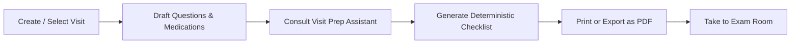

# 🌿 Appointment Prep

> **A private, responsive web application and conversational assistant that empowers patients to organize questions, track self-reported medications, and generate concise, printable clinical checklists for medical appointments.**

[](https://backendcia2.vercel.app)
[](https://reactjs.org/)
[](https://www.typescriptlang.org/)
[](https://nodejs.org/)
[](https://expressjs.com/)
[](https://www.mongodb.com/)
[](https://tailwindcss.com/)
[](https://jestjs.io/)
[-blueviolet)](#-security--privacy-safeguards)

🔗 **Live Production URL:** [https://backendcia2.vercel.app](https://backendcia2.vercel.app)

---

## 📑 Table of Contents

1. [Product Overview](#-product-overview)
2. [Key Features](#-key-features)
3. [Medical Boundary & Disclaimer](#-medical-boundary--disclaimer)
4. [Architecture & Tech Stack](#-architecture--tech-stack)
5. [Repository Structure](#-repository-structure)
6. [Getting Started](#-getting-started)
   - [Prerequisites](#prerequisites)
   - [Installation](#installation)
   - [Environment Configuration](#environment-configuration)
   - [Running the App](#running-the-app)
7. [API Contract Reference](#-api-contract-reference)
8. [Testing & Quality Assurance](#-testing--quality-assurance)
9. [Security & Privacy Architecture](#-security--privacy-architecture)
10. [Database Management & Backups](#-database-management--backups)
11. [License](#-license)

---

## 🎯 Product Overview

During standard 15-minute consultations, patients often feel rushed or overwhelmed, forgetting crucial questions, current medication schedules, and follow-up directives. 

**Appointment Prep** bridges this communication gap. It gives patients an intuitive, calm, private workspace to record their visits, brainstorm and prioritize questions, keep an accurate record of current prescriptions, and print a formatted physical checklist designed specifically for doctor consultations.

### Core User Journey


---

## ✨ Key Features

### 1. 🌿 Modern Healthcare Dashboard (Calm Sage-Green UI)
- **Weekly Readiness Curve:** Interactive SVG spline chart displaying weekly visit preparation completeness.
- **Circular Activity Ring:** Live progress visualization showing preparation score percentage and active counts.
- **Appointment Filtering:** Real-time tabs to filter visits by `All`, `Upcoming`, `Completed`, or `Cancelled`.
- **Responsive Layout:** Optimized for mobile smartphones, tablets, and wide desktop screens.

### 2. 💬 Intelligent Visit Prep Assistant
- **Conversational Small-Talk & Check-ins:** Natural, warm greeting engine that answers check-in queries (e.g. *"how are you"*, *"who are you"*, *"thank you"*).
- **Specialty-Specific Guidance:** Brainstorms tailored consultation questions for:
  - 🦷 **Dentistry:** Enamel wear, plaque, preventative sealants, routine cleaning schedule.
  - 🧴 **Dermatology:** Mole changes, rash flare-ups, sunscreen recommendations.
  - 👓 **Optometry & Vision:** Prescription changes, dry eye, blue-light strain, glaucoma screening.
  - ❤️ **Cardiology & Blood Pressure:** Target ranges, home BP logs, warning signs.
  - 🧠 **Mental Health & Therapy:** Coping strategies, progress markers, treatment modalities.
  - 👶 **Pediatrics:** Milestones, immunization schedules, nutrition and sleep.
- **Pre-Visit Anxiety Support:** Empathic coping advice for patients feeling anxious or overwhelmed before their doctor's visit.
- **Quick Suggestion Chips:** One-click topic buttons to guide users through preparation steps seamlessly.

### 3. ❓ Question Prioritizer & Organizer
- Organize questions in user-friendly language.
- Toggle status between **Asked** and **Not Asked** during or after the appointment.
- Reorder questions so your highest-priority concerns are addressed first.

### 4. 💊 Self-Reported Medication Schedule
- Capture medication/supplement brand and generic names, dosages (e.g., `500 mg`), frequencies (e.g., `Once daily with food`), and personal observations.
- User data is preserved **verbatim** without automated tampering or alteration.

### 5. 📋 One-Click Printable Clinical Checklist & PDF Export
- Deterministic transformation into a clean 4-section layout:
  1. **Visit Overview & Logistics:** Date, time, doctor name, specialty, location.
  2. **Self-Reported Medications:** Neatly tabulated with strength and dosage schedule.
  3. **Prioritized Questions for Doctor:** Formatted with physical checkboxes for the exam room.
  4. **Doctor's Notes & Action Items:** Ample lined note-taking space for handwritten advice and follow-up orders.
- **Dedicated Print Stylesheet (`@media print`):** Strips away navigation bars, action buttons, and background colors, ensuring crisp single-page output on standard Letter/A4 paper or PDF.

---

## ⚠️ Medical Boundary & Disclaimer

> **Appointment Prep is an administrative organization tool, NOT an Electronic Health Record (EHR), diagnostic device, telemedicine service, or clinical decision support system.**

- **No Diagnosis or Triage:** The system will never interpret symptoms, diagnose medical conditions, or provide clinical triage.
- **No Dosage Alterations:** The system never calculates dosages, recommends drug changes, or verifies pharmaceutical interactions.
- **Zero Hallucination Guarantee:** The backend checklist transformer strictly structures user-entered text without synthesizing unverified medical information.
- All symptom and clinical queries trigger a mandatory reminder to consult a licensed healthcare professional.

---

## 🏗️ Architecture & Tech Stack

```text
┌─────────────────────────────────────────────────────────────┐
│                      Client (SPA)                           │
│  React 18 • TypeScript • Vite • Tailwind CSS • Lucide Icons │
└──────────────────────────────┬──────────────────────────────┘
                               │ HTTPS / JSON
                               │ Credentials: include (Cookies)
                               │ Header: X-XSRF-TOKEN
┌──────────────────────────────▼──────────────────────────────┐
│                    Express 4 REST API                       │
│  Helmet • Double-Submit CSRF • Strict CORS • Rate Limiting  │
├──────────────────────────────┬──────────────────────────────┤
│  /api/v1/auth                │ Session Auth & Cookie Mgmt   │
│  /api/v1/appointments        │ Appointments CRUD            │
│  /api/v1/appointments/:id/*  │ Questions, Meds, Follow-ups  │
│  /api/v1/assistant/chat      │ Conversational Prep Engine   │
└──────────────────────────────┬──────────────────────────────┘
                               │ Mongoose 8 (ODM)
┌──────────────────────────────▼──────────────────────────────┐
│                      MongoDB Database                       │
│  User & Appointment Collections (Embedded Subdocuments)     │
└─────────────────────────────────────────────────────────────┘
```

| Tier | Component | Technology | Rationale |
|---|---|---|---|
| **Frontend** | Single Page Application | React 18, TypeScript, Vite | Sub-second HMR, type safety, fast DOM rendering |
| **Styling** | UI Design System | Tailwind CSS, Lucide Icons | Responsive, accessible tokens, bespoke print stylesheet |
| **Backend** | REST API Server | Node.js (v20+), Express 4 | Lightweight, event-driven, production-tested HTTP routing |
| **Database** | Persistence Layer | MongoDB, Mongoose 8 | Atomic subdocument updates for questions, meds, and actions |
| **Session** | Auth & Token Storage | `HttpOnly` Cookies + CSRF | Mitigates XSS token extraction; prevents cross-site request forgery |
| **Security** | Headers & Traffic Defense | Helmet, Express Rate Limit, CORS | OWASP-aligned defense-in-depth |
| **Testing** | Automated Quality Gates | Jest, Supertest, Vitest, RTL | Fast unit, integration, security, and E2E coverage |

---

## 📂 Repository Structure

```text
appointment-prep/
├── client/                     # Frontend React + TypeScript application
│   ├── src/
│   │   ├── app/                # App router and authenticated layout
│   │   ├── components/         # Navbar, Footer, Modals, ConfirmDialog
│   │   ├── context/            # AuthContext (cookie-based session state)
│   │   ├── features/
│   │   │   ├── auth/           # Login & Registration views
│   │   │   ├── appointments/   # Dashboard, Details, and Form Modals
│   │   │   ├── questions/      # Question organizer & status toggles
│   │   │   ├── medications/    # Self-reported medication list
│   │   │   ├── follow-ups/     # Action items & target due dates
│   │   │   └── checklist/      # Printable checklist & PDF export
│   │   ├── services/           # Typed API client with auto-CSRF & credentials
│   │   ├── test/               # Vitest UI test suites
│   │   └── types/              # Domain TypeScript interfaces
│   ├── index.html
│   ├── tailwind.config.js
│   └── vite.config.ts
├── server/                     # Backend Node.js + Express REST API
│   ├── src/
│   │   ├── config/             # Environment validation & DB connection
│   │   ├── middleware/         # Auth, double-submit CSRF, validation, error handler
│   │   ├── models/             # User and Appointment Mongoose schemas
│   │   ├── modules/
│   │   │   ├── auth/           # Register, login, logout, dedicated rate limiter
│   │   │   ├── appointments/   # Appointment CRUD & preparation sub-items
│   │   │   └── assistant/      # Conversational assistant & heuristic NLP engine
│   │   ├── utils/              # Cookie helpers & checklist transformer
│   │   ├── app.js              # Express app setup, CORS, and health endpoints
│   │   └── index.js            # Server entrypoint with idempotent graceful shutdown
│   └── tests/                  # Jest integration, security, auth, and E2E suites
├── docs/                       # Project documentation
│   ├── PRD.md                  # Product requirements document
│   ├── TRD.md                  # Technical specification document
│   ├── ARCHITECTURE.md         # System design & sequence diagrams
│   ├── API.md                  # Complete REST API contract
│   ├── DECISIONS.md            # Architecture decision records (ADRs)
│   ├── SECURITY_REVIEW.md      # Threat model and security findings
│   ├── UI_UX_AUDIT.md          # Screen-by-screen usability & accessibility audit
│   ├── DESIGN_SYSTEM.md        # Forest & sage green design tokens
│   ├── WORKLOG.md              # Engineering loops & audit history
│   └── TEST_REPORT.md          # Automated test execution report
├── .env.example                # Safe environment variables template
├── package.json                # Root orchestration workspace scripts
└── README.md
```

---

## 🚀 Getting Started

### Prerequisites
- **Node.js**: v20 or newer (tested on Node v25.9.0)
- **npm**: v10 or newer
- **MongoDB**: Local MongoDB instance or MongoDB Atlas URI (automated tests use built-in in-memory MongoDB)

### Installation

Clone the repository and install dependencies using lockfiles:

```bash
git clone https://github.com/saagnik23/appointment-prep.git
cd appointment-prep

# Install root dependencies
npm ci

# Install server & client dependencies
npm --prefix server ci
npm --prefix client ci
```

### Environment Configuration

Create your `.env` file from the provided `.env.example`:

```bash
cp .env.example .env
```

Review and adjust settings in `.env`:
```env
NODE_ENV=development
PORT=5001
MONGODB_URI=mongodb://127.0.0.1:27017/appointment_prep
JWT_SECRET=dev_insecure_jwt_secret_key_appointment_prep_2026_local
JWT_EXPIRES_IN=7d
CORS_ORIGIN=http://localhost:5173
CLIENT_URL=http://localhost:5173
RATE_LIMIT_MAX=500
RATE_LIMIT_WINDOW_MS=900000
AUTH_RATE_LIMIT_MAX=50
AUTH_RATE_LIMIT_WINDOW_MS=900000
```
> [!IMPORTANT]
> In production (`NODE_ENV=production`), `JWT_SECRET` must be set to a high-entropy secret of at least 32 characters (e.g. `openssl rand -hex 32`). The server will fail to start if the default development placeholder is detected.

### Running the App

Start both the API server and Vite client concurrently:

```bash
npm run dev
```

- **Client App:** [http://localhost:5173](http://localhost:5173)
- **Backend API:** [http://localhost:5001/api/v1](http://localhost:5001/api/v1)
- **Liveness Probe:** [http://localhost:5001/health](http://localhost:5001/health)
- **Readiness Probe:** [http://localhost:5001/ready](http://localhost:5001/ready)

---

## 📡 API Contract Reference

All API routes are prefixed with `/api/v1`. Authenticated routes use `HttpOnly` session cookies and require an `X-XSRF-TOKEN` header for mutating requests (`POST`, `PATCH`, `DELETE`).

| Method | Endpoint | Description | Auth Required |
|---|---|---|:---:|
| `GET` | `/health` | Liveness health check | No |
| `GET` | `/ready` | Readiness check (verifies MongoDB connection) | No |
| `POST` | `/api/v1/auth/register` | Register user and establish session cookie | No (Rate-Limited) |
| `POST` | `/api/v1/auth/login` | Authenticate user and issue session cookie | No (Rate-Limited) |
| `POST` | `/api/v1/auth/logout` | Clear session cookie and invalidate CSRF | Yes |
| `GET` | `/api/v1/auth/me` | Fetch authenticated user profile & CSRF token | Yes |
| `GET` | `/api/v1/appointments` | List owner's appointments (supports search & filter) | Yes |
| `POST` | `/api/v1/appointments` | Create a new appointment | Yes |
| `GET` | `/api/v1/appointments/:id` | Get appointment details with all sub-items | Yes |
| `PATCH` | `/api/v1/appointments/:id` | Update appointment metadata or status | Yes |
| `DELETE` | `/api/v1/appointments/:id` | Delete appointment and associated records | Yes |
| `POST` | `/api/v1/appointments/:id/questions` | Add a preparation question | Yes |
| `PATCH` | `/api/v1/appointments/:id/questions/:qId` | Update question text, status, or order | Yes |
| `DELETE` | `/api/v1/appointments/:id/questions/:qId` | Remove question | Yes |
| `POST` | `/api/v1/appointments/:id/medications` | Record self-reported medication | Yes |
| `PATCH` | `/api/v1/appointments/:id/medications/:mId` | Update medication details | Yes |
| `DELETE` | `/api/v1/appointments/:id/medications/:mId` | Remove medication | Yes |
| `POST` | `/api/v1/appointments/:id/actions` | Add follow-up action and due date | Yes |
| `PATCH` | `/api/v1/appointments/:id/actions/:aId` | Update follow-up action status | Yes |
| `DELETE` | `/api/v1/appointments/:id/actions/:aId` | Remove follow-up action | Yes |
| `GET` | `/api/v1/appointments/:id/checklist` | Generate structured, printable checklist | Yes |
| `POST` | `/api/v1/assistant/chat` | Send prompt to Visit Prep Assistant | Yes |

---

## 🧪 Testing & Quality Assurance

The codebase includes an automated test matrix with **81 tests** covering backend API routes, security boundaries, rate limiters, database disconnection handling, and React components.

```bash
# Run all automated tests (backend + frontend)
npm test

# Run backend tests only (Jest)
npm run test:server

# Run frontend tests only (Vitest)
npm run test:client

# Run standalone smoke verification
node server/tests/smoke_full_verification.js

# Build client for production
npm run build
```

### Test Suite Summary
```text
Test Suites: 14 passed (Backend: Jest + Supertest)
             4 passed (Frontend: Vitest + Testing Library)
Tests:       81 passed total (70 backend + 11 frontend)
Status:      100% green
```

---

## 🔒 Security & Privacy Safeguards

1. **HttpOnly Session Cookies:**
   - JWT tokens are stored exclusively in `HttpOnly`, `SameSite=Lax`, `Secure` (in production) cookies, completely inaccessible to JavaScript, mitigating token theft via XSS.
2. **Double-Submit CSRF Protection:**
   - All state-changing requests (`POST`, `PATCH`, `DELETE`) require a valid `X-XSRF-TOKEN` header matching the readable cookie, safeguarding against Cross-Site Request Forgery.
3. **Strict CORS Allowlist:**
   - Access is restricted to explicitly configured domains via `CORS_ORIGIN`. Unrecognized origins receive a `403 Forbidden`. Credentials are never used with wildcard `*` origins.
4. **Dedicated Auth Rate Limiting:**
   - `/api/v1/auth/login` and `/api/v1/auth/register` feature dedicated IP-based rate limiting to thwart brute-force password guessing.
5. **Strict Multi-Tenant Owner Isolation:**
   - Every appointment, question, medication, and action query strictly enforces `{ _id: recordId, ownerId: req.user.id }`. Cross-user data access is strictly prevented.
6. **Production Error Masking:**
   - Centralized error handlers mask unexpected 5xx server errors in production, preventing database connection strings, stack traces, or internal error details from leaking to clients.
7. **Idempotent Graceful Shutdown:**
   - Handlers for `SIGINT` and `SIGTERM` stop accepting new traffic, allow in-flight requests to complete within a bounded grace period, and cleanly close database connections before exiting.

---

## 💾 Database Management & Backups

To create a point-in-time snapshot or restore data:

```bash
# Create a backup
mongodump --uri="mongodb://127.0.0.1:27017/appointment_prep" --out="/backups/$(date +%F)"

# Restore a backup
mongorestore --uri="mongodb://127.0.0.1:27017/appointment_prep" --drop "/backups/YYYY-MM-DD/appointment_prep"
```

---

## 📄 License

This project is open-source software licensed under the [MIT License](LICENSE).
