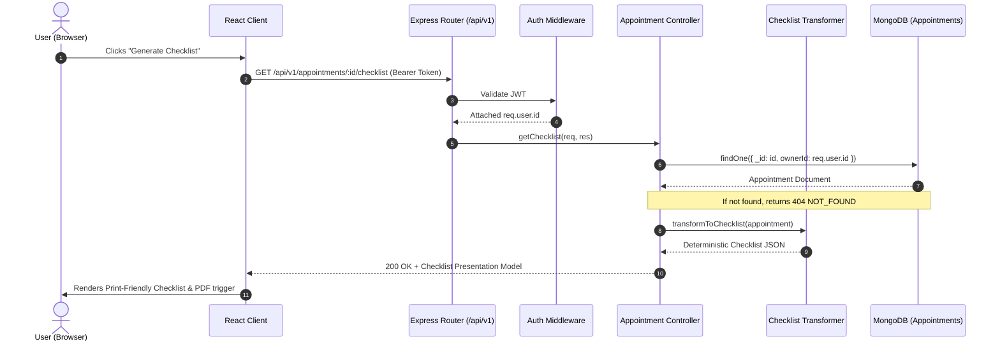

# Architecture & Data Flow — Appointment Prep

## 1. System Components

The application is structured into two decoupled, testable tiers:

### Backend Tier (`server/`)
- **`src/config/`**: Configuration loading and validation (`env.js`, `database.js`).
- **`src/middleware/`**:
  - `auth.js`: Verifies JWT from `Authorization: Bearer <token>` or HTTP-only cookies, attaches `req.user`.
  - `validate.js`: Validates request bodies, params, and queries using declarative schema rules.
  - `errorHandler.js`: Formats all errors into standardized JSON responses (`VALIDATION_ERROR`, `NOT_FOUND`, `FORBIDDEN`, `UNAUTHORIZED`, `INTERNAL_ERROR`).
- **`src/models/`**:
  - `User.js`: User credentials and metadata.
  - `Appointment.js`: Appointment model with embedded subdocuments for questions, medications, and follow-ups.
- **`src/modules/`**:
  - `auth/`: Registration, login, profile retrieval, token generation.
  - `appointments/`: Full CRUD on appointments and embedded questions, medications, follow-ups, and checklist generation.
- **`src/utils/`**:
  - `checklistTransformer.js`: Pure deterministic transformation of an appointment document into the structured checklist presentation model.

### Frontend Tier (`client/`)
- **`src/app/`**: Root application setup, routing (`react-router-dom`), global contexts (AuthContext).
- **`src/components/`**: Reusable accessible UI components (Button, Input, Modal, Badge, Card, Alert, LoadingSpinner).
- **`src/features/`**:
  - `auth/`: Login and Register forms with validation and accessible feedback.
  - `appointments/`: Appointments dashboard, appointment card, filter/search, create/edit modal.
  - `appointment-details/`: Tabbed or unified preparation view.
  - `questions/`: List, inline add/edit, asked toggle, ordering controls.
  - `medications/`: List, add/edit form (name, dose, frequency, notes), delete.
  - `follow-ups/`: Action items, due date picker, pending/completed toggle.
  - `checklist/`: Structured printable view, print button, dedicated notes area.
- **`src/services/`**: API client (`api.ts`) managing authentication headers, error serialization, and typed request methods.

---

## 2. Request & Data Flow

### Example: Checklist Generation Flow

---

## 3. Data Integrity & Authorization Boundaries

1. **Owner-Isolation Invariant:** Every query targeting an appointment or its sub-items enforces `ownerId: req.user.id`. A user with ID `A` can never read, update, or delete an appointment belonging to ID `B`.
2. **Deterministic Checklist Invariant:**
   - Checklist generation performs **zero mutations** and **zero inference**.
   - Input strings are trimmed, preserved verbatim.
   - Non-entered fields are rendered as blank or omitted (e.g. empty notes or unspecified doses).
3. **Cascade Deletion Invariant:**
   - Because questions, medications, and follow-ups are subdocuments in the appointment document, deleting an appointment inherently and atomically deletes all associated preparation items.
