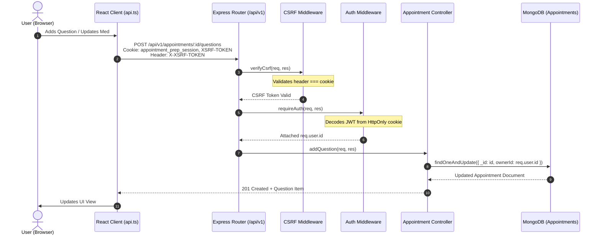

# Architecture & Data Flow — Appointment Prep

## 1. System Components

The application is structured into two decoupled, testable tiers:

### Backend Tier (`server/`)
- **`src/config/`**:
  - `env.js`: Environment loading and fail-fast validation in production.
  - `db.js`: MongoDB Mongoose connection and `isDBConnected` status helper.
- **`src/middleware/`**:
  - `auth.js`: Reads session token from `appointment_prep_session` HttpOnly cookie (or Bearer header for tests/APIs) and attaches `req.user`.
  - `csrf.js`: Verifies `X-XSRF-TOKEN` header matches `XSRF-TOKEN` cookie on mutating requests.
  - `validate.js`: Validates request bodies, params, and queries using express-validator.
  - `errorHandler.js`: Formats all errors into standardized JSON; masks 5xx internal errors in production; translates Mongoose errors into 400/409 codes.
- **`src/models/`**:
  - `User.js`: User credentials and metadata.
  - `Appointment.js`: Appointment model with embedded subdocuments for questions, medications, and follow-ups.
- **`src/modules/`**:
  - `auth/`: Registration, login, logout, profile retrieval, rate limiting, cookie generation.
  - `appointments/`: Full CRUD on appointments and embedded questions, medications, follow-ups, and checklist generation.
- **`src/utils/`**:
  - `cookies.js`: HttpOnly session and CSRF cookie generation and clearing.
  - `checklistTransformer.js`: Pure deterministic transformation of an appointment document into the structured checklist presentation model.

### Frontend Tier (`client/`)
- **`src/app/`**: Root application setup, routing (`react-router-dom`), protected route guard.
- **`src/context/`**: `AuthContext.tsx` managing session state, login, registration, and logout.
- **`src/components/`**: Reusable UI components (Navbar, Footer, Modal, ConfirmDialog).
- **`src/features/`**:
  - `auth/`: Login and Register forms with accessible WCAG 2.2 AA labels and validation.
  - `appointments/`: Appointments dashboard, search, status filter, creation/edit modal.
  - `questions/`: Question organizer (inline editing, toggle asked/not_asked, reorder).
  - `medications/`: Self-reported medication log (name, dose, frequency, notes).
  - `follow-ups/`: Action items, target due date picker, toggle completed/pending.
  - `checklist/`: Printable checklist, print trigger (`window.print()`), blank doctor notes area, and medical disclaimer.
- **`src/services/`**: API client (`api.ts`) managing credentialed requests, CSRF header attachment, and typed responses.

---

## 2. Request & Data Flow

### Example: Authenticated Mutation Flow (Double-Submit CSRF)

---

## 3. Data Integrity & Authorization Boundaries

1. **Owner-Isolation Invariant:** Every query targeting an appointment or its sub-items enforces `ownerId: req.user.id`. A user cannot read, update, or delete an appointment belonging to another user.
2. **Deterministic Checklist Invariant:**
   - Checklist generation performs **zero mutations** and **zero clinical inference**.
   - Input strings are preserved verbatim. Missing doses or frequencies remain blank.
3. **Cascade Deletion Invariant:**
   - Deleting an appointment document automatically removes all associated questions, medications, and follow-ups.
